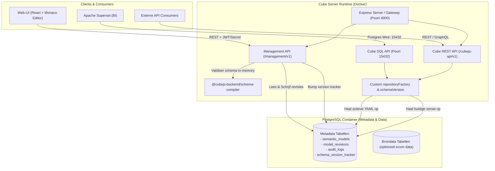

# VAS — Voxel Analytics Service: Architectuur & Implementatieplan

## 1. Overzicht en Doelstelling
**VAS (Voxel Analytics Service)** is een containerized, opensource semantische laag en metrics engine — ontworpen als het moderne, cloud-native alternatief voor **SSAS (SQL Server Analysis Services)**. 

VAS combineert de robuuste multidimensionale query- en compilatie-engine met een database-gedreven metadata-architectuur (PostgreSQL), een interactieve Web-UI, Git-versiebeheer en dynamische Row-Level (RLS) en Object-Level Security (OLS).

Belangrijke uitgangspunten:
- **100% Royalty-Free & Merkvrij:** Onafhankelijk van handelsmerken van derden onder de merknaam **VAS (Voxel Analytics Service)**.
- **Minimale impact op Core:** Geen wijzigingen in de upstream compiler- en enginebestanden; alles is gemodulariseerd in `packages/cubejs-management-api`.
- **Zero-Downtime Hot Reload:** Native `repositoryFactory` en `schemaVersion` mechanismen zorgen voor automatische en atomaire hercompilatie zodra een model via de API of UI wordt bijgewerkt.
- **Koppeling met Superset & BI-tools:** VAS SQL-API (PostgreSQL wire protocol op poort 15432) ziet wijzigingen direct na opslag.

---

## 2. Systeemarchitectuur

---

## 3. Database Model (PostgreSQL Metadata)

### 3.1 `semantic_models`
Basisregistratie van elk semantisch model (cube of view).
- `id` (UUID, Primary Key)
- `name` (VARCHAR(128), UNIQUE): Unieke naam van de cube/view (bijv. `Orders`, `Users`)
- `model_type` (VARCHAR(32)): `cube` of `view`
- `file_name` (VARCHAR(255)): Bestandsnaam (bijv. `orders.cube.yml`)
- `description` (TEXT, optioneel)
- `is_active` (BOOLEAN, default `true`): Zachte verwijdering / activatiestatus
- `created_at` (TIMESTAMPTZ, default `NOW()`)
- `updated_at` (TIMESTAMPTZ, default `NOW()`)

### 3.2 `model_revisions`
Volledig versiebeheer per model met rollback-mogelijkheid.
- `id` (UUID, Primary Key)
- `model_id` (UUID, Foreign Key naar `semantic_models(id)` ON DELETE CASCADE)
- `revision_number` (INT): Oplopend versienummer per model (1, 2, 3...)
- `content` (TEXT): De actuele YAML-definitie
- `content_format` (VARCHAR(16), default `'yaml'`): `'yaml'` of `'json'`
- `parsed_json` (JSONB, optioneel): Geïndexeerde representatie voor snelle bevraging
- `change_summary` (VARCHAR(255), optioneel): Beschrijving van de wijziging
- `status` (VARCHAR(32), default `'active'`): `'active'`, `'draft'`, `'archived'`
- `created_by` (VARCHAR(128), default `'system'`)
- `created_at` (TIMESTAMPTZ, default `NOW()`)

### 3.3 `audit_logs`
Audit-trail voor compliance en monitoring.
- `id` (BIGSERIAL, Primary Key)
- `action` (VARCHAR(64)): `CREATE`, `UPDATE`, `ROLLBACK`, `DELETE`, `VALIDATE`, `IMPORT`, `EXPORT`
- `model_name` (VARCHAR(128))
- `revision_id` (UUID, Foreign Key naar `model_revisions(id)`, optioneel)
- `details` (JSONB): Details van het verzoek, inclusief eventuele validatie-uitkomsten
- `actor` (VARCHAR(128)): Gebruiker of API-key identifier
- `ip_address` (VARCHAR(64))
- `created_at` (TIMESTAMPTZ, default `NOW()`)

### 3.4 `schema_version_tracker`
Globale versie/timestamp-teller voor Cube's `schemaVersion` hook.
- `id` (INT, Primary Key, altijd 1)
- `version` (BIGINT, autoincrement bij elke mutatie)
- `version_hash` (VARCHAR(64), MD5/SHA256 van alle actieve modellen)
- `updated_at` (TIMESTAMPTZ, default `NOW()`)

---

## 4. Fasering & Roadmap (afgestemd op Plan van Aanpak)

| Fase | Onderdeel & Scope | Status | Toelichting |
| :--- | :--- | :--- | :--- |
| **Fase 0** | **Scope, Baseline & Documentatie** - Afbakening van use-cases, drivers en BI-clients - Statuscontrole documentatie vs. code - Expliciet benoemen wat buiten scope valt | **✓ Afgerond** | PostgreSQL als primaire driver, Apache Superset & REST als primaire BI-clients. Geen DAX/MDX/XMLA. |
| **Fase 1** | **Databronnen als eerste-klas configuratie** - `data_sources` tabel & `driverFactory` routing - CRUD endpoints & afschermen van secrets - Server-side verificatie i.p.v. vertrouwen op client | **In uitvoering** | Runtime multi-database driver gereed. CRUD-beheer en secret redacting worden afgerond. |
| **Fase 2** | **Veilige en atomische modelimport** - Pre-validatie (`validateBatchSchemas`) - Atomaire transactie (`batchUpsertModels`) met 1 `schemaVersion` bump - Conflictdetectie en UI-reviewstap vóór commit | **In uitvoering** | Backend atomische transactie & join filtering gereed. UI review-/conflictenstap in aanbouw. |
| **Fase 3** | **Productiewaardige Identiteit & RBAC** - Vervangen van demo-authenticatie door centrale identity provider / JWT - Dynamische configuratie van RLS/OLS zonder hardcoding - Afschermen / beveiligen van endpoints | **Gepland** | Huidige rollen (`admin`, `sales_amsterdam`, etc.) dienen uitsluitend als prototype verificatie. |
| **Fase 4** | **Modelbeheer, Audit & Herstel** - Optimistic concurrency bij gelijktijdige edits - Gevalideerde rollbacks met audit trail - Git vs DB reconciliatie en conflictresolutie | **Gepland** | Basis rollback en Git-integratie aanwezig; hardening voor concurrentie nodig. |
| **Fase 5** | **Betrouwbaarheid, Observability & Performance** - Gestructureerde logs, metrics en health checks - Graceful handling bij database-uitval (geen leeg schema) - Benchmarks en querylimits | **Gepland** | Basis `/health` endpoint aanwezig. |
| **Fase 6** | **BI-compatibiliteit & Releasecriteria** - Geautomatiseerde Superset testsuite - Compatibility matrix en release checklist | **Gepland** | Handmatige Superset-wire verificatie geslaagd; geautomatiseerde suite volgt. |

---

## 5. Scope van de Initiële Release

### Binnen Scope
- **Brondatabases:** PostgreSQL (en PostgreSQL-compatibele DWH's zoals Timescale, CockroachDB).
- **Consumenten / Protocollen:** 
  1. Apache Superset via PostgreSQL Wire Protocol (poort 15432).
  2. Web-UI en API-integraties via REST API (poorten 4000 en 4001).
- **Semantische Capaciteiten:** Cubes, views, dimensions, measures (count, sum, avg, min, max), veilige joins (many_to_one) en pre-aggregaties.
- **Transactiemodel:** Atomaire batch publicatie met zero-downtime hot-reload in Cube.

### Expliciet Buiten Scope
- Native SSAS MDX / DAX / XMLA queries (VAS gebruikt SQL- en Cube-REST interfaces).
- Willekeurige niet-relationele NoSQL bronnen.
- Multi-tenant hosting zonder vooraf vastgesteld netwerk- en tenant-isolatieontwerp.
- Productiegebruik van ingebouwde demo-accounts (`admin`, `sales_amsterdam`, `sales_rotterdam`).

---

## 6. Data Sources & Schema Explorer Functionaliteit

### 1. Brondatabase Verbinding & Multi-Database Orchestratie
- **Default VAS Database:** Maakt direct verbinding met de actieve database via de container environment.
- **Custom / Externe Database:** Configureer Host, Poort, Database, Gebruikersnaam, Wachtwoord, Schema, SSL en **VAS Data Source ID** (bijv. `remote_dwh`). Bevat een `Test Verbinding` knop die live de latentie en beschikbare schema's teruggeeft.
- **Runtime `driverFactory`:** Externe databaseverbindingen worden persistent opgeslagen in de tabel `data_sources` in de PostgreSQL metadatadatabase. Cube's runtime `driverFactory` in `runtime/cube.js` herkent het `data_source` attribuut van de cube en routeert analytics queries dynamisch naar de juiste externe database host/poort/credentials.

### 2. Tabellen & Veilige Relaties Introspectie
- Leest `information_schema.columns` en `table_constraints` uit.
- Detecteert automatisch **Primary Keys** (`id`, etc.) en **Foreign Keys** (bijv. `sample_orders.user_id ➔ sample_users.id`).
- **Veilige Join Filter:** Voorkomt gebroken schemacompilatie door foreign key joins alleen te genereren als de doelcube daadwerkelijk bestaat in VAS of onderdeel uitmaakt van de huidige importbatch. Joins naar niet-geïmporteerde tabellen worden veilig overgeslagen (`skippedJoins`).

### 3. Atomaire Batch Table Importer & Schema Validatie
- **Pre-validatie (`validateBatchSchemas`):** De gehele batch wordt vooraf virtueel gecompileerd met de bestaande modellen vóórdat er iets naar de database geschreven wordt. Syntax- of compilatieproblemen worden vroegtijdig geblokkeerd.
- **Auto-Measures:** Maakt `count`, en genereert automatisch `sum` en `avg` maatstaven voor numerieke kolommen (zoals `amount`, `price`).
- **Atomaire Publicatie (`batchUpsertModels`):** Alle tabellen in een batch worden weggeschreven binnen **één enkele database transactie**. Pas nadat alle modellen succesvol zijn opgeslagen, wordt de `schemaVersion` tracker **exact één keer verhoogd**. Dit garandeert atomaire hot-reload zonder tussenliggende inconsistente toestanden.

---

## 7. Beveiligingsarchitectuur (SSAS-stijl RBAC, RLS & OLS Prototype)

> [!NOTE]
> Onderstaande accounts en beleidsregels zijn gerealiseerd als **verificatie-prototype** in `runtime/cube.js`. In Fase 3 van het Plan van Aanpak wordt dit vervangen door een centraal, extern configureerbaar RBAC-systeem met JWT/token-validatie en secrets management.

### Geconfigureerde Prototype Identiteiten & Rechten (Verificatie)

| Gebruikersnaam | Wachtwoord | Rol | RLS Beleid (Row-Level Security) | OLS Beleid (Object-Level Security) | Verwacht resultaat (`SELECT * FROM Orders`) |
| :--- | :--- | :--- | :--- | :--- | :--- |
| **`admin`** | `admin` | `admin` (Superuser) | Geen beperking (ziet alle rijen wereldwijd) | Alle maatstaven toegestaan (`count`, `total_amount`, `avg_order_value`) | 7 bestellingen ($2.056,46) |
| **`sales_amsterdam`** | `amsterdam123` | `sales_rep` | `Users.city = 'Amsterdam'` | `Orders.avg_order_value` **geblokkeerd** (`Access Denied`) | 2 bestellingen ($399,49) |
| **`sales_rotterdam`** | `rotterdam123` | `sales_rep` | `Users.city = 'Rotterdam'` | Standaard verkoopmaatstaven toegestaan | 2 bestellingen ($328,99) |

### Verbinding via Apache Superset / BI Tools
- **Host:** `localhost` (of `cube-core-server` binnen Docker network)
- **Poort:** `15432`
- **Database:** `cubedb`
- **Protocol:** PostgreSQL Wire Protocol v3
